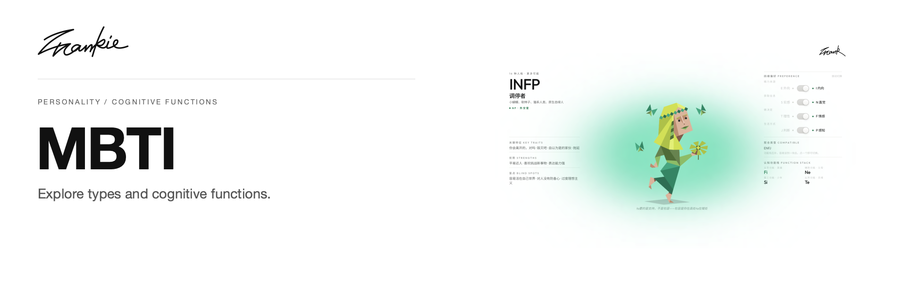

# Frank MBTI

[English](README.md) · [简体中文](README.zh-CN.md)

Explore 16 personality types through preferences, cognitive functions and relationships between types.

[Introduction](https://songhaifan.github.io/frankie-mbti/) · [Guide (中文)](docs/guide.md) · [Run locally](#run-locally)

## What it does

- Switch the four preferences and explore type profiles, function stacks and key traits.
- Browse groups, dominant functions, pairings and the type overview.
- Read perspectives by source and context, or try optional AI consultation.

## Run locally

```sh
npm ci
npm run dev
```

Open the URL printed by Next.js. Core type pages read local data; optional Neo4j and Gemini configuration is documented in `.env.example` and the project guide.

## Before you start

Core type data and perspective data are maintained separately. Core pages do not require a database. The perspectives page uses Neo4j and falls back to local seeds when it is unavailable. Graph maintenance commands and data structures are in the project guide.

## For developers

```sh
npm run graph:check
npm run build
```

[Project guide (中文)](docs/guide.md) · [Artwork](docs/readme/README.md)

---

Made by [Songhai Fan](https://github.com/SonghaiFan) · A Frankie project · [License notes](docs/guide.md#license)
