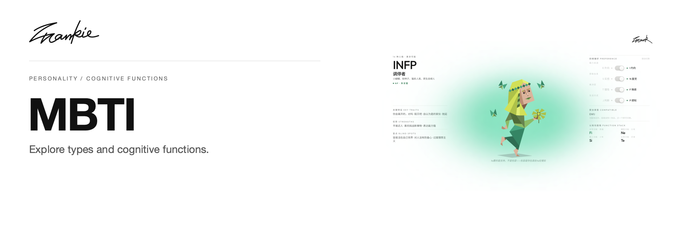

# MBTI 功能推导器

[English](README.md) · [简体中文](README.zh-CN.md)

把四维偏好、认知功能和类型关系放在一起，探索 16 种人格的不同读法。

[介绍页](https://songhaifan.github.io/frankie-mbti/zh/) · [项目指南](docs/guide.md) · [本地运行](#本地运行)

## 可以做什么

- 切换四维偏好，查看类型档案、功能栈与关键特征。
- 浏览组别、主导功能、配对关系和类型一览表。
- 按来源与情境阅读观点，或进入可选的 AI 咨询。

## 本地运行

```sh
npm ci
npm run dev
```

打开 Next.js 输出的地址。基础类型页面读取本地数据；Neo4j 和 Gemini 的可选配置见 `.env.example` 与项目指南。

## 开始之前

类型基础数据与观点数据分开维护。基础页面不依赖数据库；观点页使用 Neo4j，并在不可用时回退到本地种子。图谱维护命令和数据结构见项目指南。

## 开发说明

```sh
npm run graph:check
npm run build
```

[项目指南](docs/guide.md) · [Banner 维护](docs/readme/README.md)

---

由 [Songhai Fan](https://github.com/SonghaiFan) 制作 · Frankie 系列项目 · [许可说明](docs/guide.md#license)
